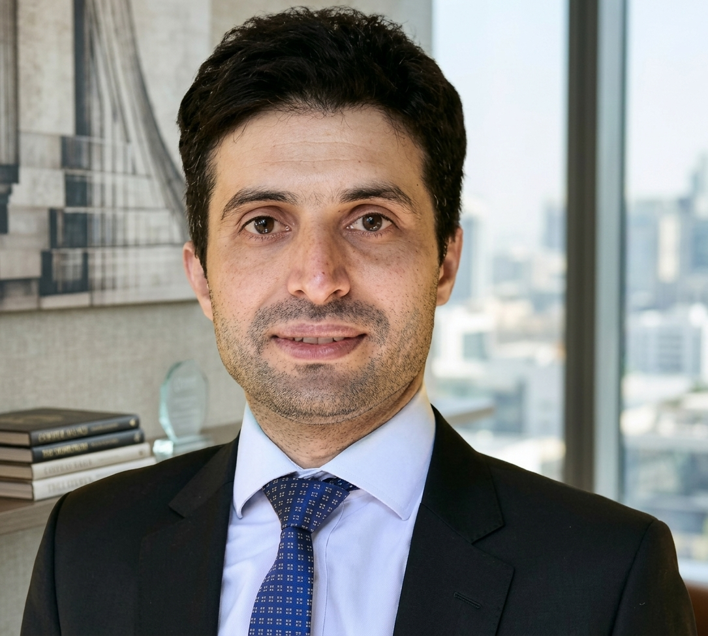

AI compiler engineer at Huawei Hong Kong Research Center, and a PhD in programming languages from the University of Hong Kong. I build the stacks that take tile-level kernels through MLIR onto Huawei Ascend NPUs, and I work on the type systems that make language designs hold together.

[GitHub](https://github.com/baberrehman/) · [LinkedIn](https://www.linkedin.com/in/baberrehman/) · [Medium](https://medium.com/@baberrehman26) · [baberrehman26@gmail.com](mailto:baberrehman26@gmail.com) · [CV](files/baber_cv.pdf)

## Work

**AI Compiler Engineer**, Huawei Hong Kong Research Center (Nov 2023–present)

I work on TileLang-Ascend, Triton-Ascend, AscendNPU-IR, and Triton-distributed-ascend: the stacks that take tile-level kernels through MLIR and lower them onto the NPU.

On TileLang-Ascend I work on the AscendNPU-IR path in the open compiler: MLIR dialects and verifiers, JIT compilation, Ascend A5 operator lowering, and the tests and CI for that pipeline. On Triton-Ascend I work on the Ascend compiler backend, including static checks on kernel scope. Triton-distributed-ascend extends the same stack to distributed kernels. Related public work is a Lean model of Triton and the Triton-Ascend core, and a Lean core for Triton-Distributed.

Earlier at the same center, I created a P4-inspired DSL for programmable networking: a high-level way to describe packet-processing logic that compiles to data-plane code.

**Software Engineer (DevOps), Team Lead**, CloudPlex, Lahore (Jun 2015–Aug 2018). Led a team in Lahore and a remote team in Argentina. Built a cloud platform for orchestration and deployment on AWS and Azure, and automated PfSense and Fortinet configuration.

**Intern**, Mentor Graphics, Lahore (Jul–Sep 2014). Debugged Sourcery CodeBench and fixed GUI bugs in Java and SWT.

## Research

PhD in Computer Science, University of Hong Kong (2018–2023), supervised by [Bruno C. d. S. Oliveira](https://i.cs.hku.hk/~bruno/). The dissertation is on intersection types and union types: how to combine them, when they stay disjoint, and how to keep the resulting languages type-sound.

Before that, a BS in Computer Science from PUCIT, University of the Punjab (2011–2015).

## Selected publications

* [Disjoint Polymorphism with Intersection and Union Types](files/FTFJP24.pdf). Baber Rehman and Bruno C. d. S. Oliveira. FTfJP 2024.
* [A Blend of Intersection Types and Union Types](files/baber_thesis.pdf). Baber Rehman. PhD dissertation, 2023.
* [Correctness-by-Construction meets Refinement Types](https://conf.researchr.org/track/ecoop-issta-2023/FTfJP-2023). Baber Rehman. FTfJP 2023.
* [Union Types with Disjoint Switches](https://doi.org/10.4230/LIPIcs.ECOOP.2022.25). Baber Rehman, Xuejing Huang, Ningning Xie, and Bruno C. d. S. Oliveira. ECOOP 2022.
* [The Duality of Subtyping](https://doi.org/10.4230/LIPIcs.ECOOP.2020.29). Bruno C. d. S. Oliveira, Shaobo Cui, and Baber Rehman. ECOOP 2020.

### Also

* [Formal Specifications for Data Plane Programs](files/formal_specs_fmano2024.pdf). Keyu Yuan and Baber Rehman. FMANO 2025.
* [Determinism with Intersection and Union Types](files/paper_src_ecoop2023.pdf). Baber Rehman and Bruno C. d. S. Oliveira. ECOOP/ISSTA student research competition, 2023. [Poster](files/poster_src_ecoop2023.pdf).
* [Type Soundness with Unrestricted Merges](files/jfp_23.pdf). Baber Rehman and Bruno C. d. S. Oliveira. Journal of Functional Programming. In submission.

### Artifacts

* [Union Types with Disjoint Switches](files/switches_ecoop2022_artifact.pdf). ECOOP 2022.
* [The Duality of Subtyping](files/duo_ecoop2020_artifact.pdf). ECOOP 2020.

## Service

Program committees and artifact evaluation, newest first.

* 2027: FormaliSE (AEC)
* 2026: ECOOP (PC), OOPSLA (AEC), POPL (AEC)
* 2025: ECOOP (AEC), OOPSLA (PC), PLDI (AEC)
* 2024: ECOOP (AEC, ERC), POPL (AEC), PLDI (AEC), ISSTA (AEC)
* 2023: ECOOP (AEC, ERC), POPL (AEC), ATC (AEC), OSDI (AEC)
* 2022: ECOOP (AEC, ERC), APLAS (AEC)

## Teaching

Teaching assistant for Functional Programming and Principles of Programming Languages at the University of Hong Kong. Visiting lecturer and teaching assistant at the University of the Punjab. Resident tutor at New College, HKU, from 2019 to 2023.

## Contact

Baber Rehman 
[baberrehman26@gmail.com](mailto:baberrehman26@gmail.com) 
[github.com/baberrehman](https://github.com/baberrehman/) 
[medium.com/@baberrehman26](https://medium.com/@baberrehman26)
